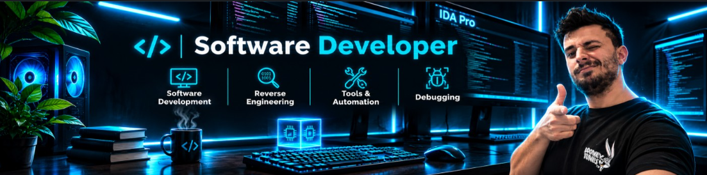

  

### Hey, I'm ViPStyl3 👋

**Developer · Automation · AI · Reverse Engineering**

*Building practical software, exploring how systems work, and turning complex problems into reliable solutions.*

---

### 💻 Languages

  
  

### 🛠️ Technologies & Tools

  
  
  
  
  

### ⚡ Areas of Interest

`Software Development` · `Desktop Applications` · `Browser Automation` · `Reverse Engineering` · `Debugging` · `AI` · `Automation`

---

  Explore my repositories to see what I'm building.

